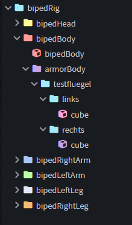
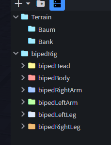
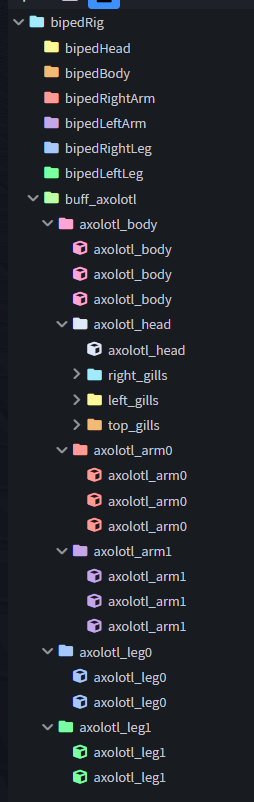
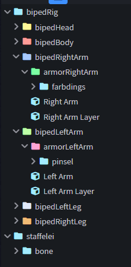

# 2. Aufbau

← [Grundlagen](01-Grundlagen) · **2 / 15** · [Model →](03-Model)

---

Gerade wenn du Emotes mit Gegenständen oder Cosmetics erstellen willst, ist die **Struktur deines Modells** besonders wichtig. Falsche Hierarchie = später nicht animierbar.

## Das Knochen-System

Alles was du erstellen willst, **muss in einen dieser Knochen**. Erkennbar sind diese Gruppen am Präfix `armor` vor dem Namen. Sie liegen im Rig, das das [NRC-Plugin](01-Grundlagen#das-spieler-rig) bei jedem neuen Projekt anlegt — jeweils **unter** dem passenden `biped`-Knochen (z.B. `bipedHead → armorHead`).

| Knochen | Bewegt sich mit |
|---------|-----------------|
| `armorHead` | Kopf |
| `armorBody` | Oberkörper |
| `armorRightArm` / `armorLeftArm` | Armen |
| `armorRightLeg` / `armorLeftLeg` | Beinen |
| `armorRightBoot` / `armorLeftBoot` | Füßen (z.B. für `SHOES`) |
| `armorRightArmSlim` / `armorLeftArmSlim` | Armen bei **schmalen Skins** (Alex-Modell) |

> 💡 Mit **Rechtsklick in die Vorschau → Toggle Slim Arms** siehst du, wie dein Modell auf schmalen Armen sitzt.

> 💡 [Buddys](13-Cosmetic-Typen#buddys) hängen nicht am Spieler — ihre Cubes kommen in einen eigenen Knochen **`armorBuddy`**, den du selbst anlegst.

> ⚠️ Cubes **direkt** in einem `biped…`-Ordner sind ingame unsichtbar. Das Plugin warnt dich beim Export („Cubes outside a bone“) — schieb sie in einen `armor…`-Ordner oder einen eigenen Unterordner.

## Cubes richtig einsortieren

### Cubes, die sich mit dem Player bewegen

Angenommen du willst **Flügel** erstellen — dann kommen die Cubes dieser Flügel in einen eigenen Ordner, und dieser Ordner kommt in den passenden `armor`-Folder.

### Cubes außerhalb des Player-Rigs

Wenn Cubes **außerhalb** des Player-Rigs sein sollen — z.B. für **Terrain** oder Gegenstände, die sich **NICHT** mit dem Main-Rig bewegen — kommen sie in einen Ordner **außerhalb** des Rigs. Den Namen dieses Ordners kannst du frei wählen — solange er **nur Kleinbuchstaben** enthält (z.B. `hammer`, nicht `Hammer`).

> ⚠️ Das gilt nur für **Emotes**. Bei **Cosmetics** werden ausschließlich Cubes in `armor…`-Ordnern gerendert — alles außerhalb bleibt unsichtbar.

> 📚 Welche Knochen-Namen der Client sonst noch besonders behandelt (Slim-Arme, `bipedRig`, `armorBuddy`, Mitspieler bei interaktiven Emotes …): → [14. Referenz – Spezielle Knochen](14-Referenz#spezielle-knochen)

## Pivot-Punkte & Rigging

> ⚠️ **WICHTIG:** Wenn du diese später angenehm animieren willst, solltest du beim Modeln die **Pivot-Punkte der Folder richtig setzen** und alle Parts, die du animieren möchtest, **einzeln riggen** — denn du kannst nur **Folder, nicht Cubes** animieren.

---

← [Grundlagen](01-Grundlagen) · **2 / 15** · [Model →](03-Model)
