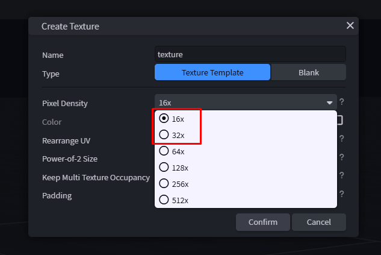

# 4. Texture

← [Model](03-Model) · **4 / 15** · [Animation →](05-Animation)

---

Nachdem du das Modell fertig hast, geht es zur **Textur**.

## Style-Guide

Die Texturen sollten im **16x** oder maximal **32x** Spektrum gehalten werden. **Zu detailreiche** Emotes/Cosmetics passen nicht in den Style von NRC und werden voraussichtlich **nicht akzeptiert**.



---

## Transparente Pixel

Transparente und halbtransparente Pixel sind **erlaubt** — sie werden ingame durchsichtig dargestellt und nicht mehr als volle Fläche gefüllt.

---

## Glow (leuchtende Pixel)

Für leuchtende Stellen legst du eine **zweite Textur** neben die normale:

```
meine_wings/
├── meine_wings.png            ← normale Textur
└── meine_wings_glowing.png    ← Glow-Textur
```

- Der Name ist fest: **`<cosmeticname>_glowing.png`**.
- Gleiche Größe und gleiches Layout wie die normale `.png`.
- Male **nur** die Pixel ein, die leuchten sollen — in der Farbe, in der sie leuchten sollen. Die Glow-Textur wird über die normale Textur gelegt.

### Ganze Teile leuchten lassen

Soll ein kompletter Teil des Modells leuchten, brauchst du keine zweite Textur: leg die Cubes in eine Gruppe mit dem Namen **`glow_0`**. Alles darin wird ingame immer in voller Helligkeit gezeigt — auch nachts.

---

## Color Change (Farbe wechseln)

Damit Spieler die Farbe ihres Cosmetics ändern können, sortierst du die färbbaren Cubes im Outliner in **Gruppen mit festem Namen**. Eine extra Textur brauchst du dafür nicht.

```
armorBody
├── tint_1_federn     ← Farbe 1, heißt im Menü „federn“
│   └── (Cubes)
├── tint_2_rand       ← Farbe 2, heißt im Menü „rand“
│   └── (Cubes)
└── gestell           ← normale Gruppe, wird nicht eingefärbt
    └── (Cubes)
```

- Name: **`tint_<nummer>`** oder **`tint_<nummer>_<name>`**, Nummer von **1 bis 8**.
- Jede Nummer ist **eine eigene Farbe**, die der Spieler einstellen kann. Mehrere Gruppen mit derselben Nummer teilen sich die Farbe.
- Der Name hinter der Nummer ist frei wählbar und wird dem Spieler als Bezeichnung angezeigt.
- Die Textur malst du **ganz normal**. Der Client macht die Flächen dieser Cubes selbst zu Graustufen und färbt sie ein: hell bleibt hell, dunkel bleibt dunkel.
- Cubes, die sich **nicht** färben sollen, dürfen sich auf der Textur keine Fläche mit gefärbten Cubes teilen.

> 💡 **Färbbar und leuchtend:** `glow_<nummer>` (Nummer 1 bis 8) funktioniert wie `tint_<nummer>` und leuchtet zusätzlich.

---

## Mehrere Texturen (multiTexture)

Soll ein Cosmetic in verschiedenen Texturen wählbar sein:

1. In der `.norisk.json` `"multiTexture": true` setzen
2. Im Cosmetic-Ordner einen Unterordner **`textures/`** anlegen
3. Alle möglichen Texturen dort hineinlegen

```
meine_wings/
├── meine_wings.norisk.json        ← "multiTexture": true
├── meine_wings.geo.json
├── meine_wings.png
└── textures/
    ├── red.png
    ├── blue.png
    └── green.png
```

Alle Texturen müssen zum selben Modell (gleiches UV-Layout) passen.

---

← [Model](03-Model) · **4 / 15** · [Animation →](05-Animation)
