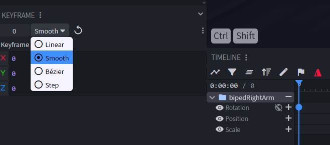
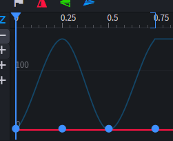
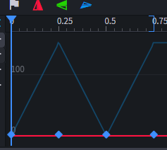
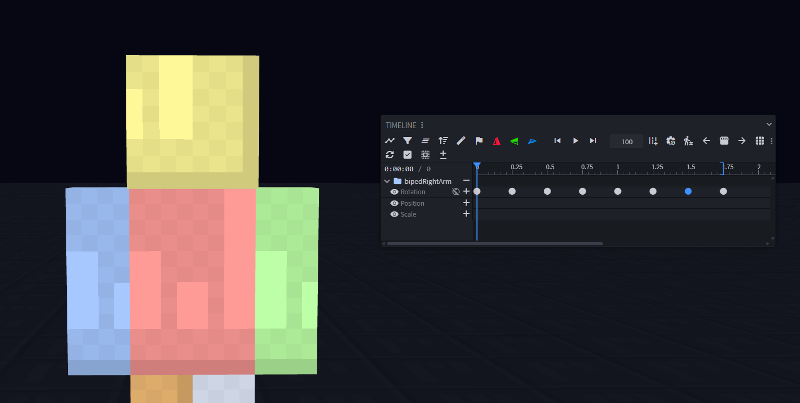
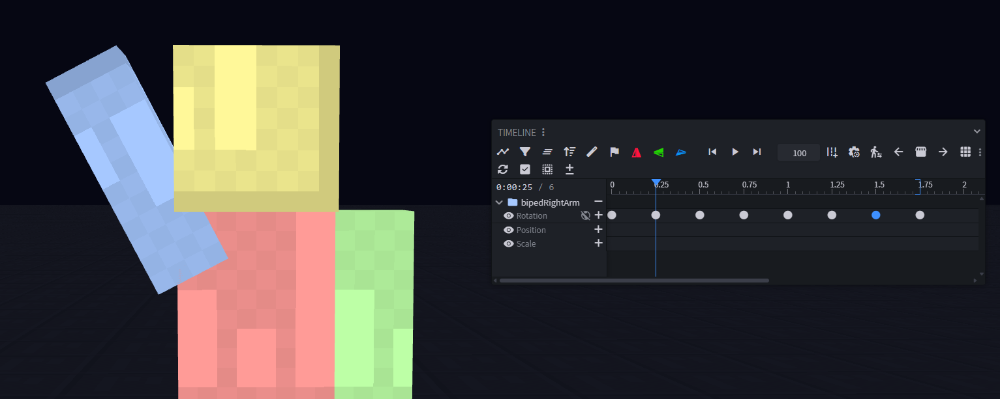
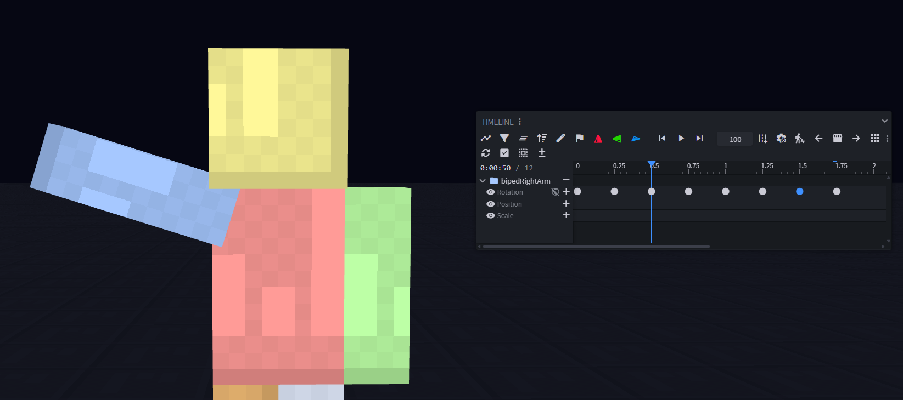
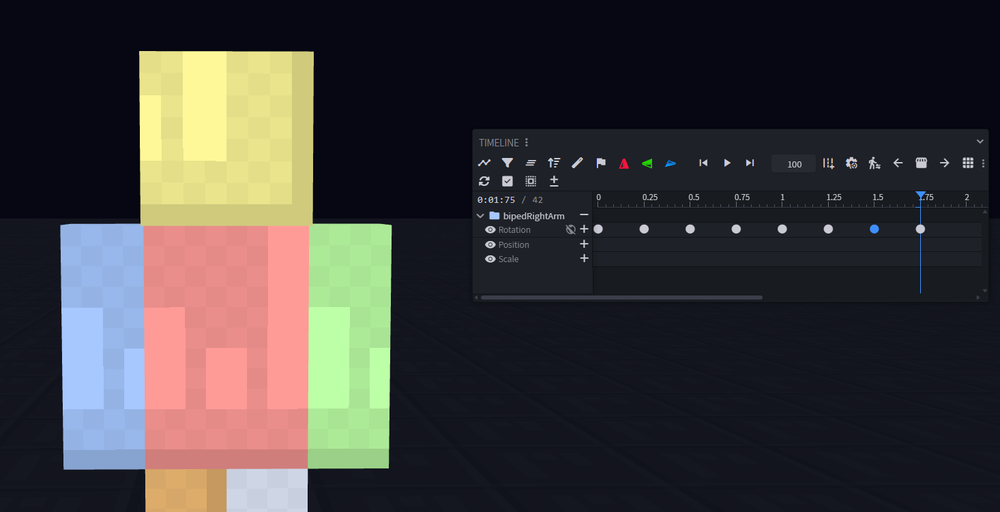
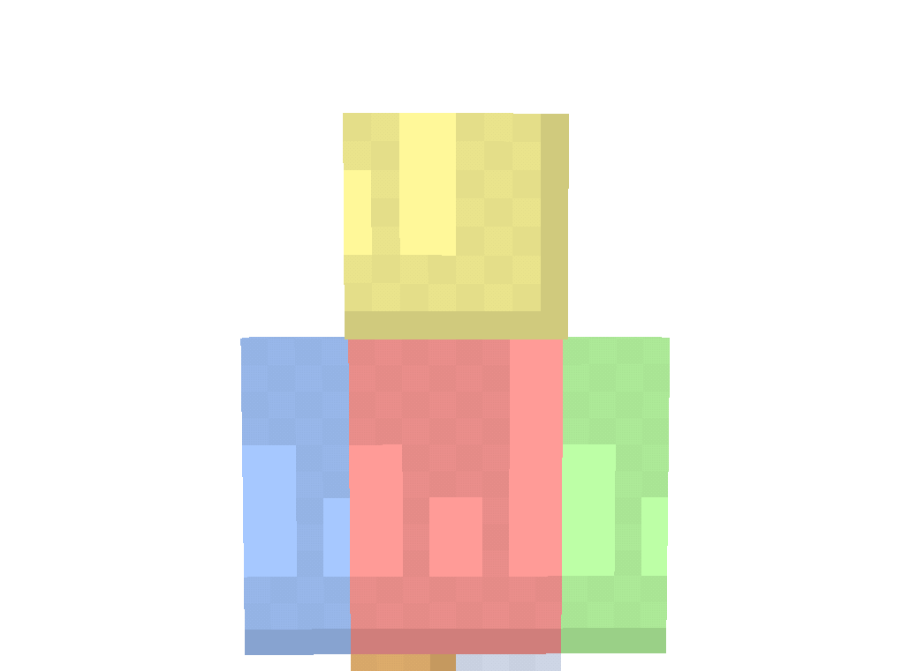

# 6. Keyframes

← [Animation](05-Animation) · **6 / 15** · [Molang →](07-Molang)

---

## Erlaubte Interpolationen

Wenn du Keyframes platzierst, kannst du die Interpolation wechseln. Der Client versteht:

| Modus | Effekt |
|-------|--------|
| **Linear** | Gleichmäßige Bewegung, harte Übergänge |
| **Smooth** | Weiche Kurve durch die Keyframes |
| **Bézier** | Eigene Kurve über Anfasser — immer ingame testen, ob es wie in Blockbench aussieht |

> 💡 Im Zweifel **Linear** oder **Smooth** nehmen — die sehen ingame garantiert genauso aus wie in Blockbench.

### Easing (nur mit dem NRC-Plugin)

Mit dem [Blockbench-Plugin](15-Blockbench-Plugin) kannst du Emote-Keyframes zusätzlich ein **Easing** geben (Keyframe auswählen → Easing im Keyframe-Panel) — z.B. `easeInOutSine` für sanftes Abbremsen, `easeOutBack` für ein kleines Überschwingen oder `easeOutBounce` zum Aufprallen. Der Client unterstützt alle Standard-Easings (Sine, Quad, Cubic, Quart, Quint, Expo, Circ, Back, Elastic, Bounce — jeweils `In`, `Out` und `InOut`).

## Visueller Unterschied

Hier siehst du den Unterschied zwischen **Smooth (1.)** und **Linear (2.)**:

## Bones bewegen

Jetzt kannst du Bones — also die Folder — **rotieren**, **positionieren** und **skalieren** wie du willst.

## Ein kleines Beispiel

**Resultat:**

---

← [Animation](05-Animation) · **6 / 15** · [Molang →](07-Molang)
