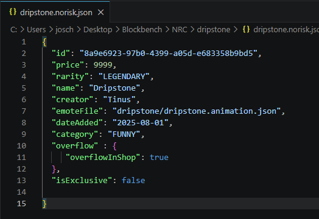
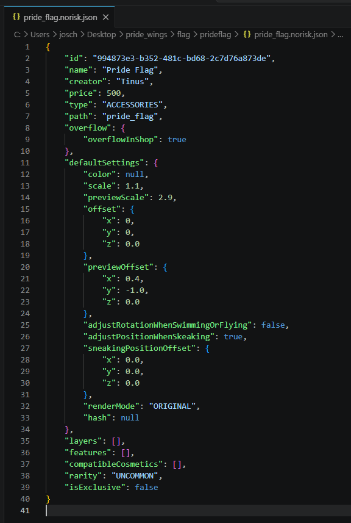
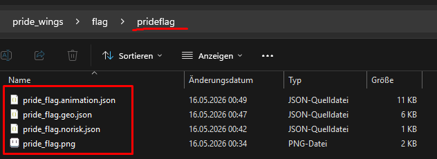
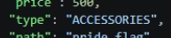
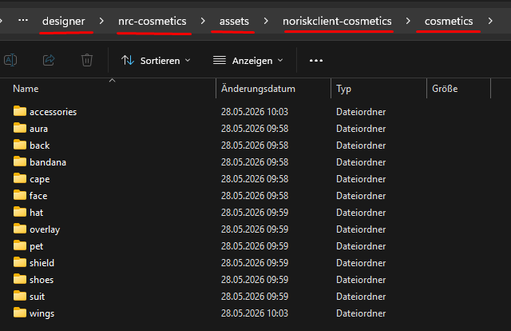
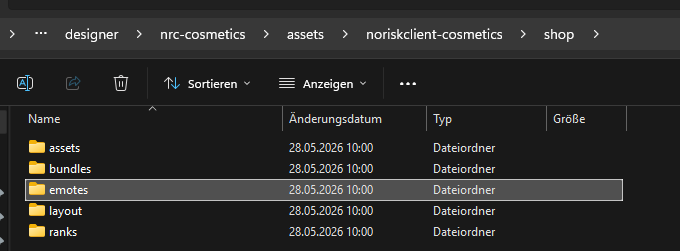
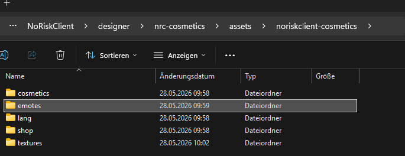

# 11. Test-Setup

← [Export](10-Export) · **11 / 15** · [Ingame-Test →](12-Ingame-Test)

---

Es gibt zwei Wege, deine Sachen ingame zu sehen:

| | **A — Test-Ordner** | **B — Designer-Ordner** |
|---|---|---|
| Für wen | **alle** | nur mit **Designer-Rechten** |
| Ordner | `NoRiskClient/test` | `NoRiskClient/designer` |
| Was du siehst | Emotes abspielen, Cosmetics tragen | zusätzlich **Shop-Ansicht**, Preise, Kategorien |
| `.norisk.json` | für Emotes nicht nötig | Pflicht |
| Neu laden | **automatisch** | `/nrc designer source rescan` |

Zum Ausprobieren reicht **A**. **B** brauchst du, wenn du sehen willst, wie dein Item im Shop aussieht.

---

## A — Test-Ordner (für alle)

Der Ordner liegt unter `<Minecraft-Ordner>/NoRiskClient/test` und wird vom Client automatisch angelegt. Am schnellsten öffnest du ihn ingame mit:

```
/nrc test folder
```

![Chat-Ausgabe von /nrc test folder mit [Open] und [Copy]](images/test-folder-command.png)

### Emotes

Einfach reinziehen — entweder nur die Animation oder den ganzen Export-Ordner:

```
NoRiskClient/test/
├── meinemote.animation.json          ← reine Animation
└── dripstone/                        ← Emote mit Gegenstand, Particle, Sound
    ├── dripstone.animation.json
    ├── dripstone.geo.json
    ├── dripstone.png
    └── dripstone.ogg
```

- Ein **Ordner** wird als Emote erkannt, wenn darin eine `<ordnername>.animation.json` liegt.
- Eine `.norisk.json` brauchst du hier **nicht**.

### Cosmetics

```
NoRiskClient/test/
└── meine_wings/
    ├── meine_wings.norisk.json       ← mit "id"
    ├── meine_wings.geo.json
    ├── meine_wings.png
    └── meine_wings.animation.json
```

Angezogen wird ein Test-Cosmetic per Command: `/nrc test cosmetic <name>` → [12. Ingame-Test](12-Ingame-Test#a--test-ordner).

### Was der Client prüft

- Namen nur aus **`a-z`, `0-9`, `.`, `_`, `-`** — alles andere wird übersprungen. Der Client sagt dir per Hinweis, welche Datei und warum, und schlägt einen gültigen Namen vor.
- Files im Ordner heißen **wie der Ordner** (`meine_wings/meine_wings.geo.json`).
- Particles: alle `*.particle.json` im Ordner werden geladen.
- Textur-Varianten liegen in einem Unterordner `textures/`.

Änderungen werden **automatisch** neu geladen, sobald du eine Datei speicherst. Weiter geht's in [12. Ingame-Test](12-Ingame-Test#a--test-ordner).

---

## B — Designer-Ordner (mit Designer-Rechten)

### Vorbereitung

Zuerst kopierst du die **Game-Assets** — also den gesamten **`nrc-cosmetics` Folder** — in den **`NoRiskClient/designer`** Ordner.

> **[⬇ nrc-cosmetics.zip herunterladen](https://github.com/NoRiskClient/nrc-designer-docs/releases/latest/download/nrc-cosmetics.zip)**

1. ZIP herunterladen
2. Entpacken — du erhältst den Ordner `nrc-cosmetics/`
3. Den **gesamten Ordner** nach `NoRiskClient/designer/` kopieren
4. Deine eigenen Emote- / Cosmetic-Files an die richtigen Stellen einsortieren (siehe unten)

> ⚠️ Der Designer-Modus ersetzt **alle** NRC-Assets durch diesen Ordner. Lass deshalb den kompletten Inhalt aus dem ZIP drin — sonst fehlen Texturen in der UI.

### `{name}.norisk.json`

Im Designer-Ordner braucht **jedes** Emote und Cosmetic eine `.norisk.json`. Am einfachsten lässt du sie vom Plugin erzeugen (**Metadata** im [Export-Dialog](10-Export#metadaten)) und ergänzt danach die fehlenden Felder.

🔧 **UUID-Generator** (falls du eine `id` von Hand brauchst): https://www.uuidgenerator.net/

#### Emotes

Das Plugin schreibt `id`, `name`, `creator`, `price`, `rarity` und `dateAdded`. **Von Hand ergänzen** musst du:

- `emoteFile` — Pfad zur Animation, relativ zum `emotes`-Ordner
- `category` — Gruppe im Emote-Menü (`SPECIAL`, `RANDOM`, `CLASSIC`, `FUNNY`, `DANCE`)

```json
{
  "id": "8a9e6923-97b0-4399-a05d-e683358b9bd5",
  "price": 9999,
  "rarity": "LEGENDARY",
  "name": "Dripstone",
  "creator": "Tinus",
  "emoteFile": "dripstone/dripstone.animation.json",
  "dateAdded": "2025-08-01",
  "category": "FUNNY",
  "overflow" : {
     "overflowInShop": true
  },
  "isExclusive": false
}
```



#### Cosmetics

Für Cosmetics wird die Datei länger, da hier zusätzlich **Scale**, **Preview** und Dinge wie das **Shop-Layout** eingestellt werden. Das Plugin legt alle Felder mit Standardwerten an — `defaultSettings` passt du danach an.

```json
{
    "id": "994873e3-b352-481c-bd68-2c7d76a873de",
    "name": "Pride Flag",
    "creator": "Tinus",
    "price": 500,
    "type": "ACCESSORIES",
    "path": "pride_flag",
    "overflow": {
        "overflowInShop": true
    },
    "defaultSettings": {
        "color": null,
        "scale": 1.1,
        "previewScale": 2.9,
        "offset": {
            "x": 0,
            "y": 0,
            "z": 0.0
        },
        "previewOffset": {
            "x": 0.4,
            "y": -1.0,
            "z": 0.0
        },
        "renderMode": "ORIGINAL"
    },
    "features": [],
    "compatibleCosmetics": [],
    "rarity": "UNCOMMON",
    "isExclusive": false
}
```



> 📚 Welche `type`-Werte es gibt, steht in [13. Cosmetic-Typen](13-Cosmetic-Typen). Alle weiteren Felder findest du in der [14. Referenz](14-Referenz).

> 💡 Die richtigen Werte für `offset` findest du am schnellsten ingame mit `/nrc cosmetics designer offset …` → [12. Ingame-Test](12-Ingame-Test#b--designer-ordner).

### Files einsortieren

#### Cosmetics

Den ganzen Export-Ordner (inklusive `.norisk.json`) in den passenden Cosmetic-Ordner legen. Als `path` steht der Ordnername in der `.norisk.json` — entscheidend ist aber, dass **alle Files gleich heißen wie die `.norisk.json`**.







#### Emotes

Für Emotes landen die Files an **zwei Stellen**:

**1. Die `.norisk.json`** — kommt in den `shop/emotes` Ordner:



**2. Die `.animation.json`** (oder bei Emotes mit Gegenstand der ganze Ordner mit `.geo` / `.animation` / `.png` / Particle / Sound) — kommt in den `emotes` Ordner:



---

## Namensregeln (für beide Wege)

Der Client findet deine Files **nur über den Dateinamen**. Das Plugin hält sich beim Export automatisch daran — wenn du von Hand umbenennst, achte darauf:

| Regel | Beispiel |
|-------|----------|
| Model, Textur und Animation heißen **genau wie der Ordner / die `.norisk.json`** | `wings.norisk.json` → `wings.geo.json`, `wings.png`, `wings.animation.json` |
| Nur **Kleinbuchstaben**, Ziffern, `_`, `-` und `.` | ✅ `pride_wings` · ❌ `PrideWings` |
| Emote mit Gegenstand: Ordner und Files heißen gleich, `.geo.json` **und** `.png` sind beide Pflicht | `emotes/dripstone/dripstone.animation.json`, `dripstone.geo.json`, `dripstone.png` |
| Particles: alle `*.particle.json` im Ordner werden geladen | `banhammer/trail.particle.json` |
| Textur-Varianten liegen in `textures/` und brauchen `"multiTexture": true` | `wings/textures/red.png`, `wings/textures/blue.png` |
| Übersetzungen kommen nach `lang/<sprache>.json`, neu laden mit **F3+T** (nur Designer-Ordner) | `lang/de_de.json` |

> ⚠️ **Kein Ordnername darf der Anfang eines anderen sein** — z.B. `hat` und `hat2` nebeneinander. Sonst lädt `hat` auch die Particles von `hat2`. Lieber `hat_red` und `hat_blue`.

> ⚠️ Jede `id` darf **nur einmal** vorkommen. Bei doppelten IDs gewinnt einfach eine der Dateien — ohne Fehlermeldung.

---

← [Export](10-Export) · **11 / 15** · [Ingame-Test →](12-Ingame-Test)
